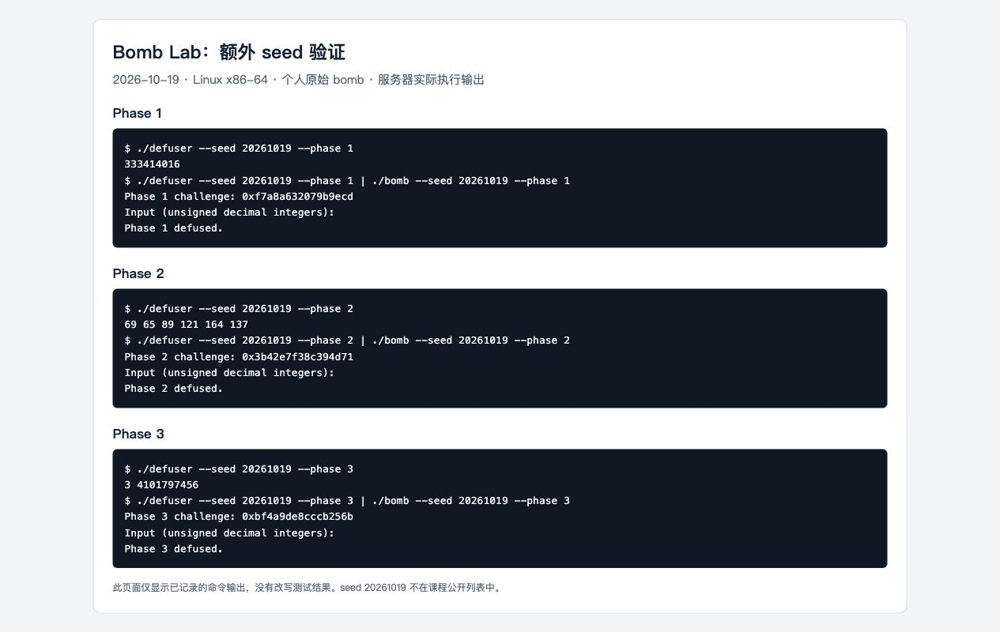
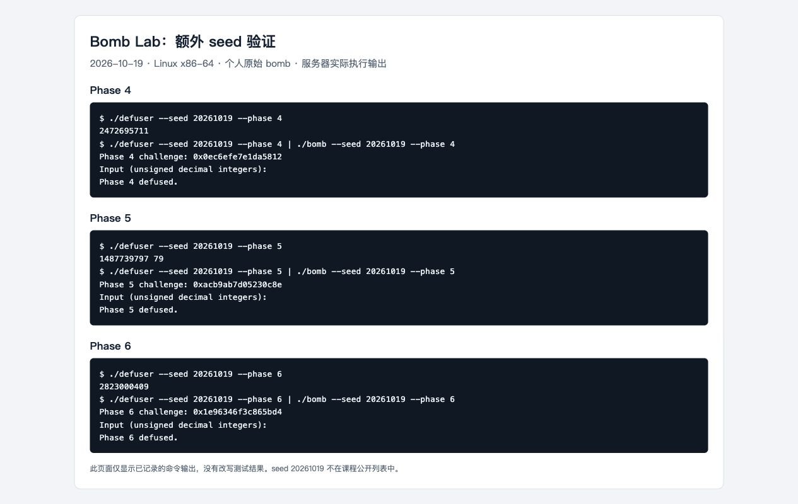
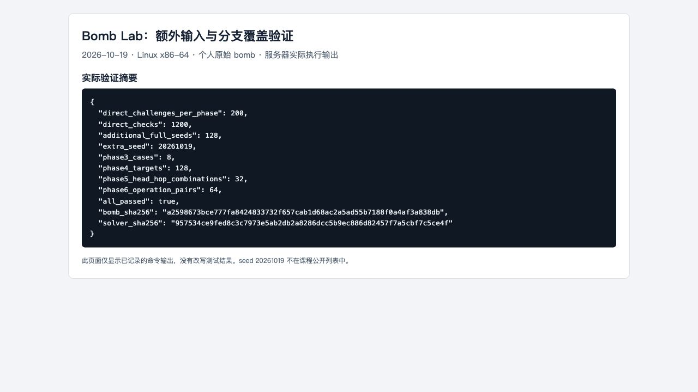

# Lab2：Bomb Lab 实验报告

## 1. 实验对象与实现约定

本实验分析个人领取的 Linux x86-64 二进制炸弹，通过反汇编恢复 challenge 到口令的计算关系，在 `defuser.c` 中实现正式六关与 Honor 的求解函数。求解过程不读取炸弹文件、不启动外部程序、不访问网络，也不使用内联汇编。

环境为 Ubuntu 24.04、GCC 13.3.0、GDB 15.1、Python 3.12.3。编译使用课程原有 Makefile 的 `-std=c11 -O2 -Wall -Wextra -Wpedantic -Werror`，未修改驱动、接口、测试、工作流或个人炸弹。

个人炸弹 SHA-256：

```text
a2598673bce777fa8424833732f657cab1d68ac2a5ad55b7188f0a4af3a838db
```

为避免有符号溢出和运算宽度不一致，以下约定贯穿所有推导：

- `C` 表示本关传入的 64 位无符号 challenge。
- `u32(x)` 表示只保留低 32 位；本文所有 32 位加减乘均按模 2^32 运算。
- `^` 为按位异或，`>>` 为无符号逻辑右移。
- `ROL32(x,n)`、`ROR32(x,n)` 表示 32 位循环左移、右移。
- seed 到 challenge 的映射及 Honor 的 context 计算由原有驱动负责，求解函数不重复实现。
- 正式关卡输出用模板的 `write_answer` 写入缓冲区，不在 out 内添加换行。

分析时使用 `objdump` 查看关卡及辅助函数，用 GDB 的 `x` 命令读取跳转表、节点和函数指针表。验证时由原始 `bomb` 检查解法输出，没有通过修改运行时寄存器、变量或内存绕过检查。

## 2. 第 1 关：调用链与返回值

### 2.1 关键指令与约束

`phase_01` 先要求口令恰有一个无符号整数，再调用 `p1_compute`，将返回的 eax 与该整数比较：

```asm
4020d8: mov  %r12,%rdi
4020db: call p1_compute
4020e0: cmp  %eax,-0x14(%rbp)
4020e3: sete %al
```

`p1_compute` 从 C 提取低 32 位、高 32 位和右移 16 位后的低 32 位，依次调用三个辅助函数。辅助函数的实际调用顺序是 step1、step0、step2，不是按名字顺序执行。

```asm
p1_step1: lea 0xc208(%rsi),%eax
          xor %edi,%eax
p1_step0: xor $0x729f,%esi
          lea (%rsi,%rdi,4),%eax
p1_step2: lea (%rdi,%rdi,2),%eax
          add $0x2192,%esi
          xor %esi,%eax
```

### 2.2 恢复关系

设 `L=u32(C)`，`H=u32(C>>32)`，`M=u32(C>>16)`：

```text
A = H ^ u32(M + 0xc208)
B = u32(4*L + (H ^ 0x729f))
answer = u32(3*B) ^ u32(A + 0x2192)
```

其中 lea 只进行乘加，不读取内存。函数返回的 32 位结果按无符号十进制输出即可。

额外 seed `20261019` 的 C 为 `0xf7a8a632079b9ecd`，解法输出 `333414016`，原始炸弹输出 `Phase 1 defused.`。

## 3. 第 2 关：数组与循环递推

### 3.1 关键指令与约束

输入解析检查要求六个整数。首项取自 challenge 的部分位：

```asm
402160: shr $0x4,%rax
402164: and $0x3f,%eax
402167: lea (%rax,%rax,2),%eax
40216a: cmp %eax,%esi
```

循环中 ecx 初始为 10，每轮加 3；edi 初始为 9，每轮加 9；rdx 每轮前进 4 字节，比较下一个数组元素：

```asm
40217f: shr %cl,%rax
402182: and $0xf,%eax
402185: add %esi,%eax
40218a: xor %edi,%eax
40218c: cmp %eax,%esi
402190: add $0x3,%ecx
402193: add $0x9,%edi
40219a: cmp $0x19,%ecx
```

### 3.2 恢复关系

```text
a[0] = 3 * ((C >> 4) & 63)
a[i] = u32(a[i-1] + ((C >> (7+3*i)) & 15)) ^ (9*i), i=1..5
```

退出条件是在移位计数更新为 25 时结束，所以实际使用的移位量为 10、13、16、19、22，共五次递推，连同首项一共六个数。

额外 seed `20261019` 的 C 为 `0x3b42e7f38c394d71`，输出为：

```text
69 65 89 121 164 137
```

原始炸弹输出 `Phase 2 defused.`。

## 4. 第 3 关：switch 与跳转表

### 4.1 索引和操作数

`phase_03` 要求两个整数。第一项必须等于 `C&7`，第二项来自分派函数：

```asm
402301: and $0x7,%edi
402304: cmp %edi,-0x18(%rbp)
40230f: shr $0x3,%rax
402313: shr $0x20,%rsi
402317: xor %eax,%esi
402319: call p3_dispatch
```

因此令 `index=C&7`，`x=u32(C>>3)^u32(C>>32)`。

### 4.2 按实际表项恢复分支

```asm
402258: cmp $0x7,%eax
40225b: ja  4022a5
40225d: notrack jmp *0x405820(,%rax,8)
```

用 GDB `x/8gx 0x405820` 读取八个 8 字节目标地址，并继续追踪各目标中的 jmp，得到以下映射。不能把 index 直接当作 `p3_case_N` 中的 N。

| index | 实际 case 函数 | 第二项 y，结果取低 32 位 |
| --- | --- | --- |
| 0 | case_2 | `(2*x) ^ 0x6999` |
| 1 | case_1 | `3*x + 0xa9b8` |
| 2 | case_5 | `(4*x) ^ 0x7eae` |
| 3 | case_6 | `3*x + 0x8a81` |
| 4 | case_7 | `5*x + 0x43189` |
| 5 | case_0 | `5*x + 0x24a81` |
| 6 | case_3 | `(x ^ 0x479b) + (x >> 1)` |
| 7 | case_4 | `(x ^ 0xccdc) + (x >> 2)` |

额外 seed `20261019` 的 C 为 `0xbf4a9de8cccb256b`，输出 `3 4101797456`，原始炸弹输出 `Phase 3 defused.`。

前三关的非公开 seed 运行记录截图：



## 5. 第 4 关：递归路径与返回值组合

### 5.1 入口参数

`phase_04` 检查一个整数，并调用 `p4_walk`：

```asm
4023f3: shr $0x20,%rax
4023f7: shr $0x7,%rcx
4023fb: and $0x7f,%edi
4023fe: mov $0x7f,%edx
402403: xor %eax,%ecx
402405: call p4_walk
```

由此得到 target=`C&127`，low=0，high=127，salt=`u32(C>>7)^u32(C>>32)`。

### 5.2 递推式

函数先计算 `mid=low+((high-low)>>1)`。target 与 mid 相等时：

```asm
402390: lea 0xdc(%rdi),%eax
402396: xor %ecx,%eax
```

不相等时递归进入左半或右半，递归返回后将结果乘 5，再与当前层的数据异或。完整定义为：

```text
F(t,l,h,s):
    m = l + ((h-l)>>1)
    若 t == m：返回 (m+0xdc) ^ s
    若 t <  m：返回 u32(5*F(t,l,m-1,s)) ^ u32(m+s) ^ 2
    若 t >  m：返回 u32(5*F(t,m+1,h,s)) ^ u32(m+s) ^ 0x1f
```

目标保证在 0..127 内，每次区间严格缩小，因此可直接递归实现，不需要枚举目标。重要的是自内向外组合返回值，而不是只恢复二分搜索经过的节点。

额外 seed `20261019` 的 C 为 `0x0ec6efe7e1da5812`，target=18，输出 `2472695711`，原始炸弹输出 `Phase 4 defused.`。

## 6. 第 5 关：结构体布局与链表遍历

### 6.1 从访问偏移恢复布局

```asm
402434: mov 0x405b60(,%rax,8),%rdx
402447: mov 0x4(%rdx),%esi
40244c: xor (%rdx),%eax
402464: mov 0x8(%rdx),%rdx
```

这些指令分别读取起点指针、节点偏移 4 的 32 位字段、偏移 0 的 32 位字段和偏移 8 的 next 指针。节点区相邻对象相差 16 字节，恢复布局为：

```c
struct Node {
    uint32_t value;  /* +0 */
    uint32_t tag;    /* +4 */
    struct Node *next; /* +8 */
};
```

### 6.2 静态节点与起点

以 `0x405ba0` 为节点 0，GDB 读取的静态数据如下。代码使用节点编号表示链接，避免依赖运行地址。

| 编号 | value | tag | next 编号 |
| --- | --- | --- | --- |
| 0 | 0x1108 | 0x227 | 4 |
| 1 | 0xf610 | 0x684 | 10 |
| 2 | 0x8fc4 | 0x30b | 7 |
| 3 | 0xd5c4 | 0x120 | NULL |
| 4 | 0xf07d | 0x923 | 1 |
| 5 | 0x80a6 | 0x56d | 2 |
| 6 | 0xff48 | 0xa17 | 8 |
| 7 | 0x17cb | 0x830 | 3 |
| 8 | 0xd4f5 | 0x04f | 5 |
| 9 | 0x5f4f | 0x435 | 11 |
| 10 | 0x5e1e | 0xb20 | 9 |
| 11 | 0x47df | 0x77f | 6 |

起点表 `heads={0,4,1,10,9,11,6,8}`；它是程序数据，不是按公开 seed 硬编码的答案表。

### 6.3 遍历关系

```text
node = heads[C & 7]
hops = (C >> 3) & 3
acc = u32(C>>6) ^ u32(C>>32) ^ 0x1d9b
依次处理起点及沿 next 前进 hops 次遇到的节点：
    acc = u32((acc ^ node.value) + node.tag)
输出 acc 和最后一个节点的 tag
```

汇编在循环前已处理起点，所以处理节点数是 `hops+1`，不能漏掉起点。所有起点和最多三次跳转均不会解引用 NULL。

额外 seed `20261019` 的 C 为 `0xacb9ab7d05230c8e`：起点为节点 6，hops=1，路径为 6→8，输出 `1487739797 79`，原始炸弹输出 `Phase 5 defused.`。

## 7. 第 6 关：函数指针表和两次间接调用

### 7.1 调用关系

```asm
4025a3: and $0x7,%eax
4025a6: call *0x405e00(,%rax,8)
4025ad: xor $0x438,%eax
4025b2: mov %eax,%edi
4025b4: call *0x405e00(%rbx)
4025bf: add $0x3dc0,%eax
```

第一项索引为 `i=C&7`；第二次调用前 rbx 已变为 `C&0x38`，这是以字节计算的偏移，因此第二项索引为 `j=(C>>3)&7`，不是直接使用 `C&0x38` 作为数组下标。

令 `x=u32(C>>6)^u32(C>>32)`，最终答案为：

```text
answer = u32(T[j](T[i](x) ^ 0x438) + 0x3dc0)
```

### 7.2 八项表与实际运算

GDB `x/8gx 0x405e00` 得到的实际函数编号顺序是 `{3,1,5,4,5,2,5,0}`。三个不同索引指向同一个 op_5，不能假设表项互不相同。

| 函数 | 32 位运算 |
| --- | --- |
| op_0 | `ROL32(x,1) ^ 0xf45e` |
| op_1 | `(x ^ 0x8eaa) + (x << 5)` |
| op_2 | `((x << 7) + 0x1396) ^ (3*x)` |
| op_3 | `ROR32(x,3)` |
| op_4 | `(x + 0xd8d6) ^ (x >> 5)` |
| op_5 | `((x >> 2) ^ x) + 0xca1d` |

循环移位必须保留从一端移出的位，不能用单纯左移或右移替代。

额外 seed `20261019` 的 C 为 `0x1e96346f3c865bd4`，输出 `2823000409`，原始炸弹输出 `Phase 6 defused.`。

后三关的非公开 seed 运行记录截图：



## 8. Honor：相邻字段覆盖与三项计算

### 8.1 入口条件和布局

Honor 需要在六关通过后，经文件或管道提供完整第七行。入口 `secret_gate(input, challenge, context)` 将输入复制到局部对象，再检查门字段及后面的口令：

```asm
40274b: lea  -0xd0(%rbp),%r12
402771: sub  $0x24,%rax
402775: cmp  $0x7f,%rax
402796: call secret_copy
40279b: cmpl $0x4e45504f,-0xb0(%rbp)
4027ad: lea  -0xac(%rbp),%rdi
4027b4: call secret_phase
```

`strlen(input)-36` 按无符号比较不超过 127，所以允许长度为 36..163。复制起点是 rbp-0xd0；门字段在 rbp-0xb0，距离起点 32 字节；数字口令起点在 rbp-0xac，距离起点 36 字节。

在小端序下，字节 `O P E N` 对应 32 位值 `0x4e45504f`。因此构造格式为：

```text
32 个 A + OPEN + 三个空格分隔的无符号十进制整数
```

`secret_copy` 逐字节复制至零终止符，没有按前面的字符字段长度截断；输入由此覆盖同一局部对象中的相邻门字段。这里不需要覆盖返回地址，也没有修改炸弹程序或调试器中的数据。

### 8.2 三项计算关系

令 C 为 Honor challenge，K 为 context，`c=u32(C)^u32(C>>32)`，`k=u32(K)^u32(K>>32)`。

`secret_phase` 要求三个数，第一项来自 K 的低两位；`secret_mix` 的核心指令为：

```asm
402636: rol $0x7,%eax
402639: add $0x3070,%eax
40263e: xor $0xaed9,%eax
```

结合调用前后的寄存器关系，恢复：

```text
a = u32(K) & 3
m = u32(ROL32(c ^ k,7) + 0x3070) ^ 0xaed9
b = m ^ (u32(a*0x3070) ^ u32(K>>16))
d = b ^ u32(k + a + 0xaed9 + (c>>7))
```

完整第七行输出 `A×32 + OPEN + a + 空格 + b + 空格 + d`，不额外加入换行。即使三项都取最大十位十进制表示，整行也不超过 68 字节，满足门函数的长度范围及驱动的 256 字节缓冲区限制。

六关输出也参与 context 的生成，因此 Honor 验证使用同一个 seed 的前六行和第七行，不能拼接不同运行的答案。

### 8.3 非公开 seed 验证

```bash
{ ./defuser --seed 20261019; ./defuser --secret --seed 20261019; } | ./bomb --seed 20261019
```

实际输出六次 `Phase N defused.` 和 `Secret phase defused.`：


## 9. 验证结果与覆盖范围

### 9.1 原有公开测试

执行 `make` 和 `make test`，编译无警告，结果为：

```text
Public tests: 60/60
Secret public tests: 10/10
```


### 9.2 公开列表之外的 seed

`tests/public.json` 中不含 `20261019`。上述每关都单独使用该 seed 验证，完整七行运行也通过。记录如下：

| 关卡 | seed 20261019 的输出 | 原始炸弹结果 |
| --- | --- | --- |
| 1 | `333414016` | Phase 1 defused. |
| 2 | `69 65 89 121 164 137` | Phase 2 defused. |
| 3 | `3 4101797456` | Phase 3 defused. |
| 4 | `2472695711` | Phase 4 defused. |
| 5 | `1487739797 79` | Phase 5 defused. |
| 6 | `2823000409` | Phase 6 defused. |
| Honor | 第八节构造的完整第七行 | Secret phase defused. |

### 9.3 边界和结构覆盖

使用固定的额外验证脚本，对每关直接传入 200 个 challenge：

- 128 个 challenge 令低 7 位依次取 0..127，高 57 位由固定种子 `Random(20261019)` 产生。
- 8 个边界值：0、1、2^64-1、2^63、2^32-1、2^32、2^31-1、2^31。
- 64 个额外伪随机 64 位 challenge。

这组测试覆盖第三关全部 8 个分支、第四关全部 128 个目标、第五关全部 32 种起点与跳数配置、第六关全部 64 种两次函数表索引组合。六关共 1200 次验证均通过。

此外，使用 128 个不属于公开列表的 seed，逐一生成六关口令和 Honor 口令，交给原始炸弹完整检查，全部通过。额外脚本只负责启动测试，不进入 `defuser.c`，也没有修改课程测试文件。



这些是本地验证结果，不代表已经执行助教隐藏测试或已经取得最终分数。

### 9.4 图片与记录说明

本报告图片均为浏览器对真实命令输出查看页的截图：原始 stdout 来自指定服务器上的实际执行，查看页只排版显示记录，没有伪造终端界面或改写通关结果。公开测试图为筛选后的结果摘要，明确保留了每关 seed 42、六关汇总以及全部 Honor 结果。

图片全部放在 `images/`，以上引用均为相对路径，不依赖本地磁盘绝对位置。完整验证日志保留在服务器 `/root/bomblab-learning/verification/`，不作为整份调试日志提交到作业仓库。

## 10. 提交内容与工具使用说明

本次提交材料为：

```text
defuser.c
report.md
images/
bomb
```

`bomb` 是原样领取的个人文件，用于公开 Actions 测试；解法不读取该文件。编译产物 `defuser`、tutor 编译产物、完整反汇编和调试日志不加入提交材料。`config.txt` 与 `package.json` 不作为本次提交内容。

AI 辅助说明：本次使用 Codex 协助读取反汇编和静态数据、恢复计算关系、编写 `defuser.c`、设计并执行额外验证、整理报告和截图。报告所列运行结果来自真实执行，不将 AI 生成过程描述成提交者独立完成的分析。提交者仍需依据课程公告确认工具使用范围，并亲自复现、理解和解释代码与推导。

Git 提交和 `final` 标签属于提交操作状态，不作为通关证明；是否推送由提交者控制。本次准备阶段未执行 `git push origin final`。

## 11. 参考资料

1. [课程 Lab2 指导](https://ics-26fall-fdu.github.io/labs/lab2-bomb-lab/)：实验接口、输出格式、测试和提交要求。
2. [课程 BombLab 模板](https://github.com/ICS-26Fall-FDU/BombLab)：本次使用的驱动、公开测试、tutor 与配套 C 例子。
3. Randal E. Bryant、David R. O’Hallaron，《深入理解计算机系统》第三版第三章：调用约定、控制流、结构体、指针与栈布局。
4. [GDB 官方手册](https://sourceware.org/gdb/current/onlinedocs/gdb.html/)：反汇编与内存查看命令。
5. 个人原始二进制的 `phase_01`～`phase_06`、相关辅助函数、`secret_gate`、`secret_copy`、`secret_phase` 及静态数据区：实际推导与验证对象。
