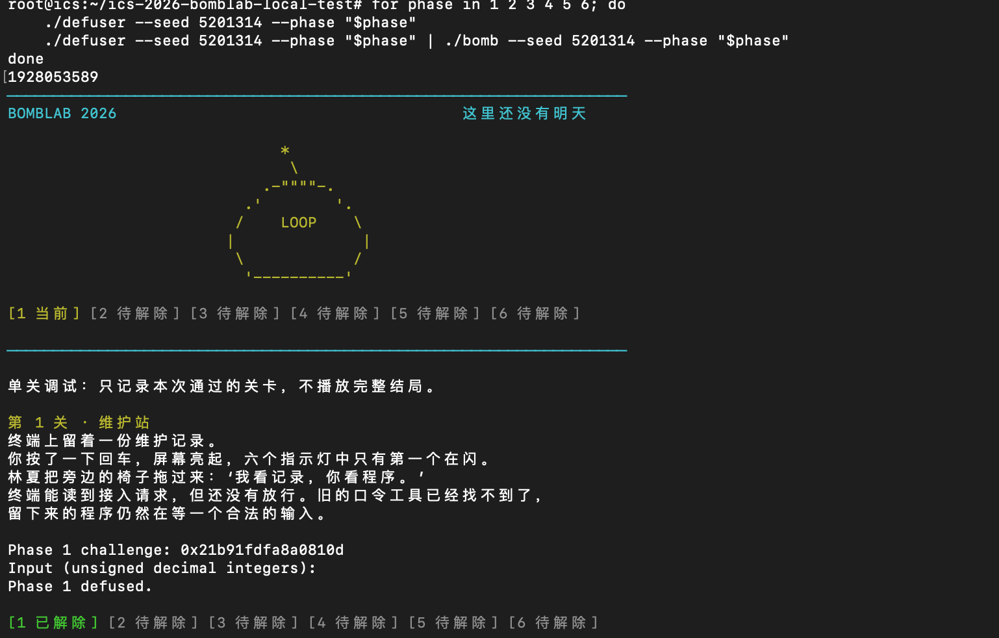
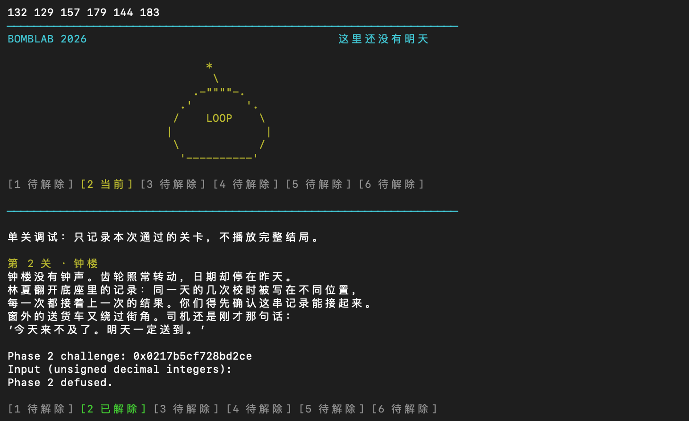
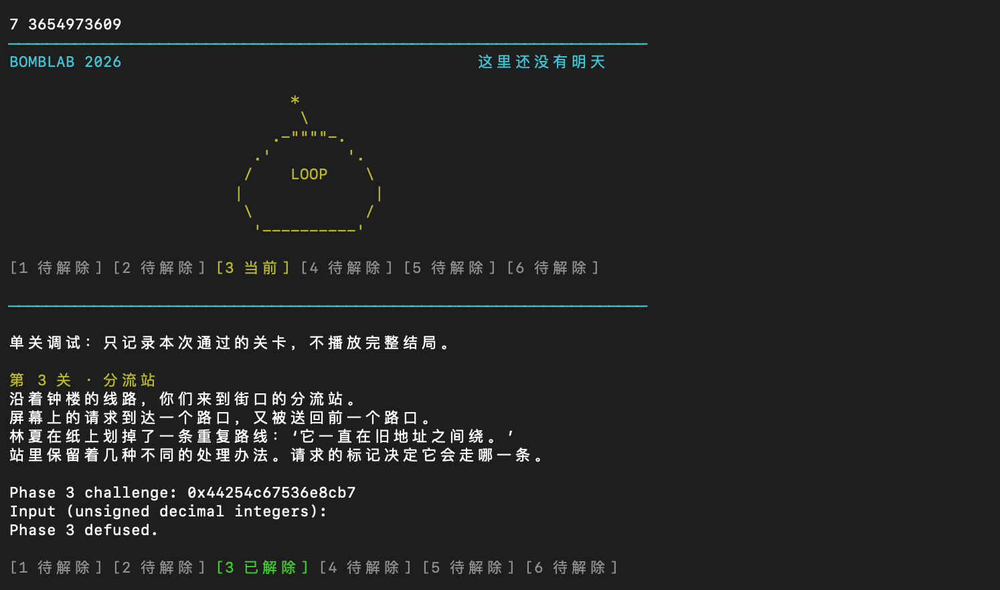
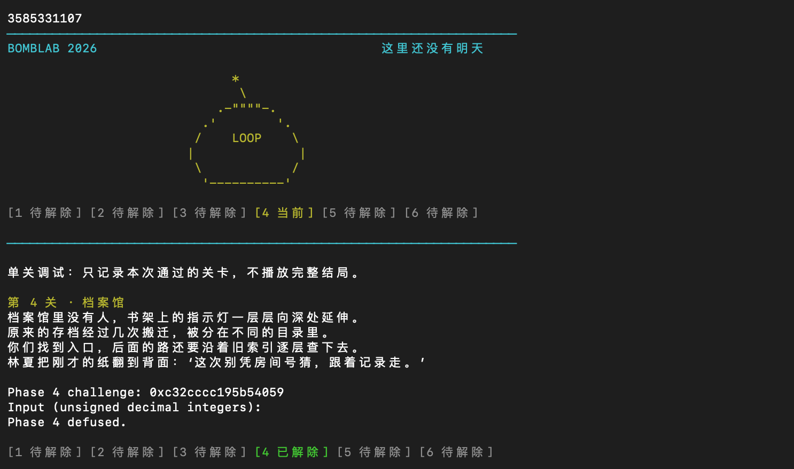
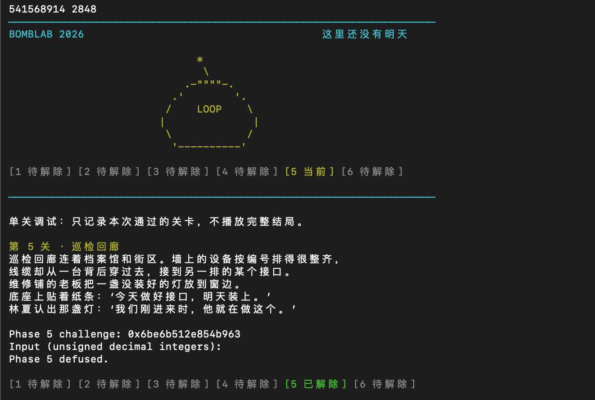
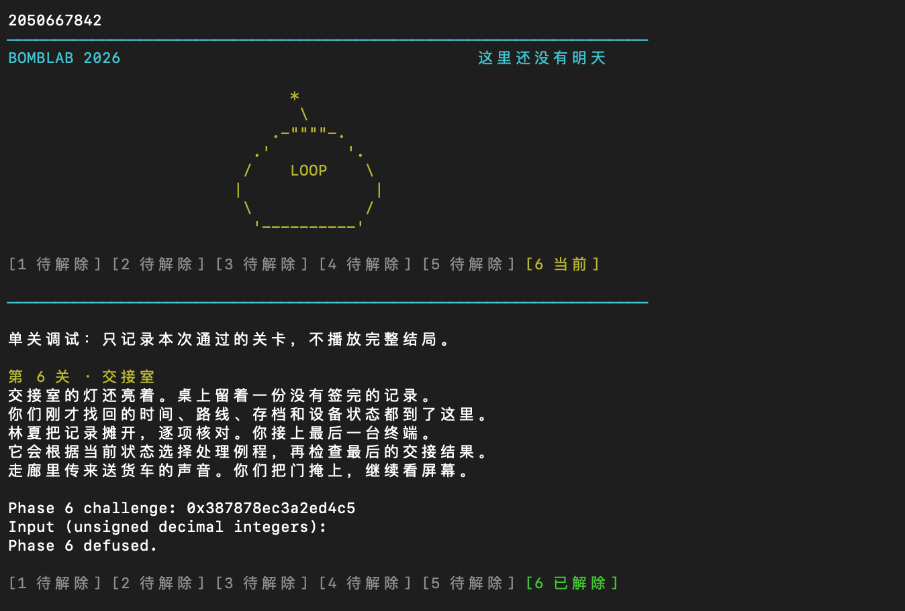
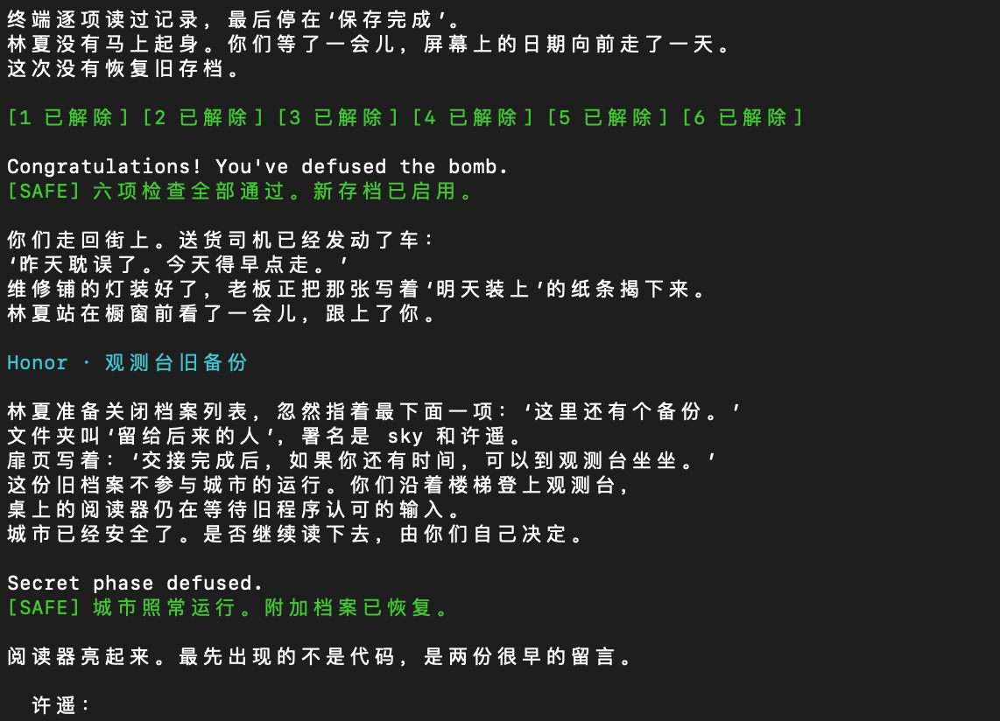
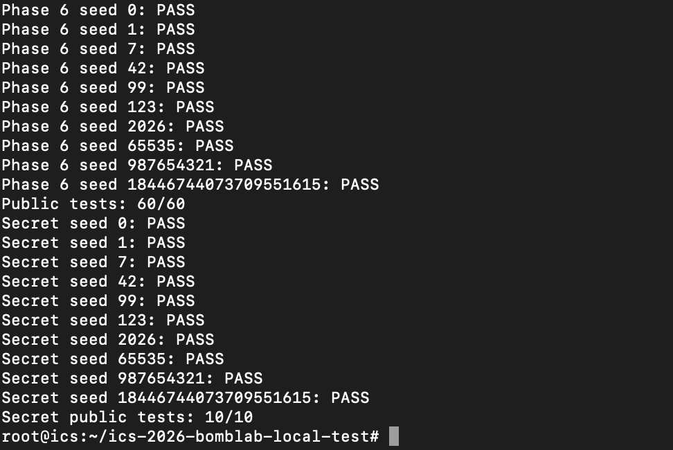

# Lab2：Bomb Lab 实验报告
刘秉毅 25800190124
## 1. 实验对象与实现约定

本实验分析个人领取的 Linux x86-64 二进制炸弹，通过反汇编恢复 challenge 到口令的计算关系，在 `defuser.c` 中实现正式六关与 Honor 的求解函数。

环境为 Ubuntu 24.04、GCC 13.3.0、GDB 15.1、Python 3.12.3。


个人炸弹 SHA-256（学号25800190124）：

```text
a2598673bce777fa8424833732f657cab1d68ac2a5ad55b7188f0a4af3a838db
```

## 2. 第 1 关：调用链与返回值

### 题目思路

`phase_01` 先要求口令恰有一个无符号整数，再调用 `p1_compute`，将返回的 eax 与该整数比较：

```asm
4020d8: mov  %r12,%rdi
4020db: call p1_compute
4020e0: cmp  %eax,-0x14(%rbp)
4020e3: sete %al
```

`p1_compute` 从 C 提取低 32 位、高 32 位和右移 16 位后的低 32 位，依次调用三个辅助函数。

```asm
p1_step1: lea 0xc208(%rsi),%eax
          xor %edi,%eax
p1_step0: xor $0x729f,%esi
          lea (%rsi,%rdi,4),%eax
p1_step2: lea (%rdi,%rdi,2),%eax
          add $0x2192,%esi
          xor %esi,%eax
```

设 `L=u32(C)`，`H=u32(C>>32)`，`M=u32(C>>16)`：

```text
A = H ^ u32(M + 0xc208)
B = u32(4*L + (H ^ 0x729f))
answer = u32(3*B) ^ u32(A + 0x2192)
```

其中 lea 只进行乘加，不读取内存。函数返回的 32 位结果按无符号十进制输出即可。

### 简要说明实现

`solve_phase_1` 提取 challenge 的低 32 位、高 32 位及右移 16 位后的低 32 位，按三个辅助函数的实际调用顺序计算。中间结果使用 `uint32_t` 保留回绕行为，最后用 `write_answer` 输出一个整数。

### 完成截图

额外 seed `5201314` 的 C 为 `0x21b91fdfa8a0810d`，解法输出 `1928053589`，原始炸弹输出 `Phase 1 defused.`。



## 3. 第 2 关：数组与循环递推

### 题目思路

输入解析检查要求六个整数。首项取自 challenge 的部分位：

```asm
402160: shr $0x4,%rax
402164: and $0x3f,%eax
402167: lea (%rax,%rax,2),%eax
40216a: cmp %eax,%esi
```

循环中 ecx 初始为 10，每轮加 3；edi 初始为 9，每轮加 9；rdx 每轮前进 4 字节，比较下一个数组元素：

```asm
40217f: shr %cl,%rax
402182: and $0xf,%eax
402185: add %esi,%eax
40218a: xor %edi,%eax
40218c: cmp %eax,%esi
402190: add $0x3,%ecx
402193: add $0x9,%edi
40219a: cmp $0x19,%ecx
```

```text
a[0] = 3 * ((C >> 4) & 63)
a[i] = u32(a[i-1] + ((C >> (7+3*i)) & 15)) ^ (9*i), i=1..5
```

退出条件是在移位计数更新为 25 时结束，所以实际使用的移位量为 10、13、16、19、22，共五次递推，连同首项一共六个数。

### 简要说明实现

`solve_phase_2` 先计算首项，再用一次循环填入第 1～5 项，最后输出六个整数。初值与循环分开处理，确保不漏首项、不多算最后一项。

### 完成截图

额外 seed `5201314` 的 C 为 `0x0217b5cf728bd2ce`，输出为：

```text
132 129 157 179 144 183
```

原始炸弹输出 `Phase 2 defused.`。



## 4. 第 3 关：switch 与跳转表

### 题目思路

`phase_03` 要求两个整数。第一项必须等于 `C&7`，第二项来自分派函数：

```asm
402301: and $0x7,%edi
402304: cmp %edi,-0x18(%rbp)
40230f: shr $0x3,%rax
402313: shr $0x20,%rsi
402317: xor %eax,%esi
402319: call p3_dispatch
```

因此令 `index=C&7`，`x=u32(C>>3)^u32(C>>32)`。

```asm
402258: cmp $0x7,%eax
40225b: ja  4022a5
40225d: notrack jmp *0x405820(,%rax,8)
```

用 GDB `x/8gx 0x405820` 读取八个 8 字节目标地址，并继续追踪各目标中的 jmp，得到以下映射。不能把 index 直接当作 `p3_case_N` 中的 N。

| index | 实际 case 函数 | 第二项 y，结果取低 32 位 |
| --- | --- | --- |
| 0 | case_2 | `(2*x) ^ 0x6999` |
| 1 | case_1 | `3*x + 0xa9b8` |
| 2 | case_5 | `(4*x) ^ 0x7eae` |
| 3 | case_6 | `3*x + 0x8a81` |
| 4 | case_7 | `5*x + 0x43189` |
| 5 | case_0 | `5*x + 0x24a81` |
| 6 | case_3 | `(x ^ 0x479b) + (x >> 1)` |
| 7 | case_4 | `(x ^ 0xccdc) + (x >> 2)` |

### 简要说明实现

`solve_phase_3` 提取 index 和 x，使用 switch 按真实跳转表顺序计算第二项，输出 `index y`。

### 完成截图

额外 seed `5201314` 的 C 为 `0x44254c67536e8cb7`，输出 `7 3654973609`，原始炸弹输出 `Phase 3 defused.`。



## 5. 第 4 关：递归路径与返回值组合

### 题目思路

`phase_04` 检查一个整数，并调用 `p4_walk`：

```asm
4023f3: shr $0x20,%rax
4023f7: shr $0x7,%rcx
4023fb: and $0x7f,%edi
4023fe: mov $0x7f,%edx
402403: xor %eax,%ecx
402405: call p4_walk
```

由此得到 target=`C&127`，low=0，high=127，salt=`u32(C>>7)^u32(C>>32)`。

函数先计算 `mid=low+((high-low)>>1)`。target 与 mid 相等时：

```asm
402390: lea 0xdc(%rdi),%eax
402396: xor %ecx,%eax
```

不相等时递归进入左半或右半，递归返回后将结果乘 5，再与当前层的数据异或。完整定义为：

```text
F(t,l,h,s):
    m = l + ((h-l)>>1)
    若 t == m：返回 (m+0xdc) ^ s
    若 t <  m：返回 u32(5*F(t,l,m-1,s)) ^ u32(m+s) ^ 2
    若 t >  m：返回 u32(5*F(t,m+1,h,s)) ^ u32(m+s) ^ 0x1f
```

目标保证在 0..127 内，每次区间严格缩小，因此可直接递归实现，不需要枚举目标。

### 简要说明实现

辅助函数 `walk` 保留基本情况、左右递归分支以及逐层返回值的组合规则；`solve_phase_4` 设置 target、区间和 salt 后，输出递归计算结果。

### 完成截图

额外 seed `5201314` 的 C 为 `0xc32cccc195b54059`，target=89，输出 `3585331107`，原始炸弹输出 `Phase 4 defused.`。



## 6. 第 5 关：结构体布局与链表遍历

### 题目思路

```asm
402434: mov 0x405b60(,%rax,8),%rdx
402447: mov 0x4(%rdx),%esi
40244c: xor (%rdx),%eax
402464: mov 0x8(%rdx),%rdx
```

这些指令分别读取起点指针、节点偏移 4 的 32 位字段、偏移 0 的 32 位字段和偏移 8 的 next 指针。节点区相邻对象相差 16 字节，恢复布局为：

```c
struct Node {
    uint32_t value;  /* +0 */
    uint32_t tag;    /* +4 */
    struct Node *next; /* +8 */
};
```

以 `0x405ba0` 为节点 0，GDB 读取的静态数据如下。代码使用节点编号表示链接，避免依赖运行地址。

| 编号 | value | tag | next 编号 |
| --- | --- | --- | --- |
| 0 | 0x1108 | 0x227 | 4 |
| 1 | 0xf610 | 0x684 | 10 |
| 2 | 0x8fc4 | 0x30b | 7 |
| 3 | 0xd5c4 | 0x120 | NULL |
| 4 | 0xf07d | 0x923 | 1 |
| 5 | 0x80a6 | 0x56d | 2 |
| 6 | 0xff48 | 0xa17 | 8 |
| 7 | 0x17cb | 0x830 | 3 |
| 8 | 0xd4f5 | 0x04f | 5 |
| 9 | 0x5f4f | 0x435 | 11 |
| 10 | 0x5e1e | 0xb20 | 9 |
| 11 | 0x47df | 0x77f | 6 |

起点表 `heads={0,4,1,10,9,11,6,8}`；
```text
node = heads[C & 7]
hops = (C >> 3) & 3
acc = u32(C>>6) ^ u32(C>>32) ^ 0x1d9b
依次处理起点及沿 next 前进 hops 次遇到的节点：
    acc = u32((acc ^ node.value) + node.tag)
输出 acc 和最后一个节点的 tag
```

不过汇编在循环前已处理起点，所以处理节点数是 `hops+1`。

### 简要说明实现

`solve_phase_5` 将恢复出的 value、tag、next 保存为静态节点数组，以节点编号代替运行地址。遍历时处理起点及后续 hops 次跳转，共 `hops+1` 个节点，输出累计值和最后节点的 tag。

### 完成截图

额外 seed `5201314` 的 C 为 `0x6be6b512e854b963`：起点为节点 10，hops=0，只处理该起点，输出 `541568914 2848`，原始炸弹输出 `Phase 5 defused.`。



## 7. 第 6 关：函数指针表和两次间接调用

### 题目思路

```asm
4025a3: and $0x7,%eax
4025a6: call *0x405e00(,%rax,8)
4025ad: xor $0x438,%eax
4025b2: mov %eax,%edi
4025b4: call *0x405e00(%rbx)
4025bf: add $0x3dc0,%eax
```

第一项索引为 `i=C&7`；第二次调用前 rbx 已变为 `C&0x38`，这是以字节计算的偏移，因此第二项索引为 `j=(C>>3)&7`，不是直接使用 `C&0x38` 作为数组下标。

令 `x=u32(C>>6)^u32(C>>32)`，最终答案为：

```text
answer = u32(T[j](T[i](x) ^ 0x438) + 0x3dc0)
```

GDB `x/8gx 0x405e00` 得到的实际函数编号顺序是 `{3,1,5,4,5,2,5,0}`，三个不同索引指向同一个 op_5。

| 函数 | 32 位运算 |
| --- | --- |
| op_0 | `ROL32(x,1) ^ 0xf45e` |
| op_1 | `(x ^ 0x8eaa) + (x << 5)` |
| op_2 | `((x << 7) + 0x1396) ^ (3*x)` |
| op_3 | `ROR32(x,3)` |
| op_4 | `(x + 0xd8d6) ^ (x >> 5)` |
| op_5 | `((x >> 2) ^ x) + 0xca1d` |


### 简要说明实现

`apply_operation` 按八项函数表实现各索引对应的操作；`solve_phase_6` 提取两个索引，依次完成两次分派，在中间异或 `0x438`，末尾加 `0x3dc0`。循环移位使用无符号 32 位运算，保留移出的位。

### 完成截图

额外 seed `5201314` 的 C 为 `0x387878ec3a2ed4c5`，输出 `2050667842`，原始炸弹输出 `Phase 6 defused.`。



## 8. Honor：相邻字段覆盖与三项计算

### 题目思路

Honor 需要在六关通过后，经文件或管道提供完整第七行。入口 `secret_gate(input, challenge, context)` 将输入复制到局部对象，再检查门字段及后面的口令：

```asm
40274b: lea  -0xd0(%rbp),%r12
402771: sub  $0x24,%rax
402775: cmp  $0x7f,%rax
402796: call secret_copy
40279b: cmpl $0x4e45504f,-0xb0(%rbp)
4027ad: lea  -0xac(%rbp),%rdi
4027b4: call secret_phase
```

`strlen(input)-36` 按无符号比较不超过 127，所以允许长度为 36..163。复制起点是 rbp-0xd0；门字段在 rbp-0xb0，距离起点 32 字节；数字口令起点在 rbp-0xac，距离起点 36 字节。

在小端序下，字节 `O P E N` 对应 32 位值 `0x4e45504f`。因此构造格式为：

```text
32 个 A + OPEN + 三个空格分隔的无符号十进制整数
```

`secret_copy` 逐字节复制至零终止符，没有按前面的字符字段长度截断；输入由此覆盖同一局部对象中的相邻门字段。

令 C 为 Honor challenge，K 为 context，`c=u32(C)^u32(C>>32)`，`k=u32(K)^u32(K>>32)`。

`secret_phase` 要求三个数，第一项来自 K 的低两位；`secret_mix` 的核心指令为：

```asm
402636: rol $0x7,%eax
402639: add $0x3070,%eax
40263e: xor $0xaed9,%eax
```

结合调用前后的寄存器关系，恢复：

```text
a = u32(K) & 3
m = u32(ROL32(c ^ k,7) + 0x3070) ^ 0xaed9
b = m ^ (u32(a*0x3070) ^ u32(K>>16))
d = b ^ u32(k + a + 0xaed9 + (c>>7))
```


### 简要说明实现

`solve_secret` 根据 challenge 和 context 计算 a、b、d，用 `snprintf` 写出“32 个 A + OPEN + 三项整数”的完整第七行，并检查是否截断。context 由原驱动根据前六行生成，前六关与 Honor 使用相同 seed。

### 完成截图

```bash
{ ./defuser --seed 5201314; ./defuser --secret --seed 5201314; } | ./bomb --seed 5201314
```

完整复测输出六次 `Phase N defused.` 和 `Secret phase defused.`；下图截取终端的最终六关完成与 Honor 成功提示：



## 9. 验证结果与覆盖范围

### 9.1 原有公开测试

执行 `make -B defuser` 和 `python3 public_test.py`，结果为：

```text
Public tests: 60/60
Secret public tests: 10/10
```



### 9.2 公开列表之外的 seed

`tests/public.json` 中不含 `5201314`。上述每关都单独使用该 seed 验证，完整七行运行也通过。记录如下：

| 关卡 | seed 5201314 的输出 | 原始炸弹结果 |
| --- | --- | --- |
| 1 | `1928053589` | Phase 1 defused. |
| 2 | `132 129 157 179 144 183` | Phase 2 defused. |
| 3 | `7 3654973609` | Phase 3 defused. |
| 4 | `3585331107` | Phase 4 defused. |
| 5 | `541568914 2848` | Phase 5 defused. |
| 6 | `2050667842` | Phase 6 defused. |
| Honor | 第八节构造的完整第七行 | Secret phase defused. |

### 9.3 复测步骤与图片说明

在服务器的测试目录中，依次运行：

```bash
make -B defuser && python3 public_test.py
for phase in 1 2 3 4 5 6; do
    ./defuser --seed 5201314 --phase "$phase"
    ./defuser --seed 5201314 --phase "$phase" | ./bomb --seed 5201314 --phase "$phase"
done
{ ./defuser --seed 5201314; ./defuser --secret --seed 5201314; } | ./bomb --seed 5201314
```


## 10. 提交内容与工具使用说明

本次提交材料为：

```text
defuser.c
report.md
images/
bomb
```


AI 辅助说明：使用 Codex 协助读取反汇编和静态数据、编写 `defuser.c`及整理报告。多数用于调试代码，寻找问题所在。


## 11. 参考资料

1. [课程 Lab2 指导](https://ics-26fall-fdu.github.io/labs/lab2-bomb-lab/)：实验接口、输出格式、测试和提交要求。
2. [课程 BombLab 模板](https://github.com/ICS-26Fall-FDU/BombLab)：本次使用的驱动、公开测试、tutor 与配套 C 例子。
3. Randal E. Bryant、David R. O’Hallaron，《深入理解计算机系统》第三版第三章：调用约定、控制流、结构体、指针与栈布局。
4. [GDB 官方手册](https://sourceware.org/gdb/current/onlinedocs/gdb.html/)：反汇编与内存查看命令。

